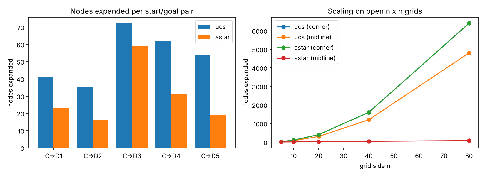
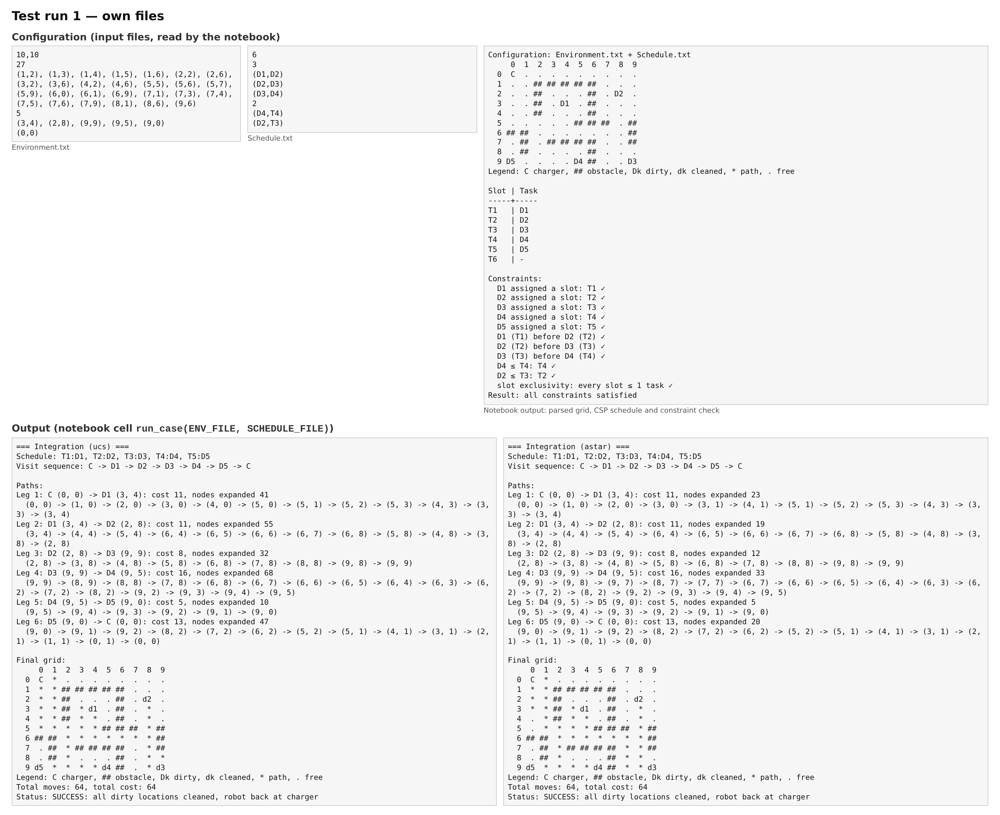
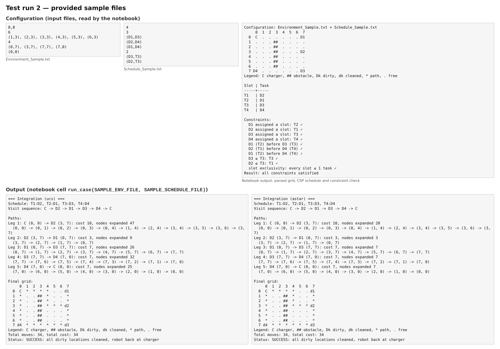
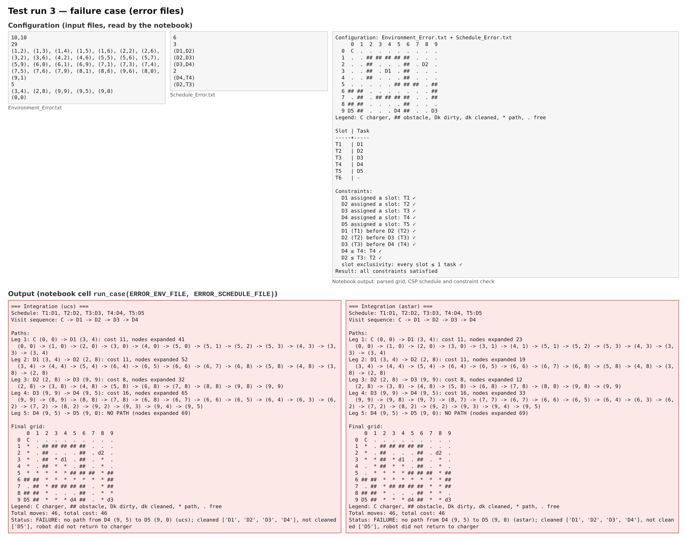

# Intelligent Vacuum-Cleaning Robot: Graph Search and CSP Scheduling

CS-323 Artificial Intelligence, Complex Engineering Problem, TE Batch 2024, Fall 2026.
Group: Muhammad Ashar Khan (CS-24035), Huzaifa Hanif (CS-24039), Muhammad Ahmed Qazi (CS-24045),
Mujtaba Jawaid Rao (CS-24047). Notebook: `CS24045.ipynb`.

Design choices the specification leaves open are team decisions, recorded in our decision log
as DEC-01 … DEC-15. They are cited by ID below and are not part of the specification.

## 1. Problem Definition and Representation

A vacuum-cleaning robot works in a rectangular room divided into cells. Some cells are obstacles,
some are dirty, and one is the charging station. The robot must (1) choose a time slot for every
cleaning task so that all scheduling constraints hold, then (2) navigate from the charger to each
dirty cell in slot order and back to the charger, using graph search.

**Environment grid.** `Grid` is an immutable record with `rows`, `cols`, the set of `obstacles`, the
dirty cells `dirty` (label → cell, in file order, labels `D1…Dn`) and the `charger` cell (DEC-06).
Coordinates are zero-based `(row, col)` with `(0, 0)` at the top left. Dirty cells and the charger
are passable; only obstacles and out-of-bounds cells are blocked.

**Search problem (navigation leg).**

| Element | Representation |
|---|---|
| State | the robot's cell `(row, col)` |
| Initial state | the leg's start cell (charger or previous dirty cell) |
| Actions | `UP (−1,0)`, `DOWN (+1,0)`, `LEFT (0,−1)`, `RIGHT (0,+1)`, tried in that order (DEC-06) |
| Transition model | `get_successors(state, grid)`: apply the action; keep the result if it is inside the grid and not an obstacle |
| Goal test | `goal_test(state, goal_state)`: the robot is on the leg's target cell |
| Step cost | 1 per move; `path_cost(path) = len(path) − 1`, and `0` for an empty path (DEC-04) |

**CSP (scheduling).** Variables are the task labels `D1…Dn` (all dirty cells, including tasks with
no constraint). The domain of each variable is the slots `{1, …, T}`, where `T` comes from line 1 of
`Schedule.txt`; slots are integers and are shown as `T1…TT` (DEC-06). There are three constraint types:

* *Precedence* `(Di, Dj)`: slot(Di) < slot(Dj).
* *Latest slot* `(Di, Tk)`: slot(Di) ≤ k.
* *Slot exclusivity* (implicit): no two tasks share a slot.

**Input formats.** `Environment.txt` has six lines: `rows,cols`; number of obstacles; obstacle
tuples; number of dirty cells; dirty-cell tuples; charger tuple. `Schedule.txt` has: number of slots;
number of precedence pairs; one `(Di,Dj)` per line; number of latest-slot constraints; one
`(Di,Tk)` per line. Both files are read at run time; nothing is hard-coded. The parsers raise a single
`InputError` naming the file, line and problem (DEC-07). The rules for whitespace, empty lists and
value checks (duplicates, overlaps, out-of-bounds cells, unknown labels) are DEC-08 … DEC-13.

Our own environment (`Environment.txt`) is a 10×10 room with 27 obstacles forming two walls and a
pocket, 5 dirty cells, and the charger at `(0,0)`. `Schedule.txt` has 6 slots, the precedence chain
D1→D2→D3→D4, and the limits D4 ≤ T4 and D2 ≤ T3. D5 is unconstrained, so it tests the "every task
gets a slot" rule.

## 2. Graph-Based Search Algorithms

We implemented Uniform-Cost Search (uninformed) and A\* (informed) (DEC-01). Both are one best-first
**graph search** in `search(grid, start, goal, algorithm)`; they differ only in the priority:

* **UCS** expands the frontier node with the lowest path cost *g(n)*. With non-negative step costs, it
  is complete and optimal: when a node is removed from the frontier, its cheapest path is known.
* **A\*** expands the node with the lowest *f(n) = g(n) + h(n)*, where *h* estimates the remaining
  cost. With a consistent *h* it is complete and optimal, and it expands no node with
  *f > C\** (the optimal cost). This is why it usually expands fewer nodes than UCS.

Shared implementation details: a binary heap is the frontier. Ties are broken by insertion order, so
results are deterministic. A node is goal-tested when it is *popped*, not when it is generated,
because testing on generation can return a non-optimal path. A `closed` set ensures each cell is
expanded at most once. A node counts as expanded when its successors are generated (DEC-14). `search`
returns `(path, cost, nodes_expanded)`, or `(None, None, nodes_expanded)` when no path exists; for
start = goal it returns `([start], 0, 0)`. An unknown algorithm name raises `ValueError`.

```
function SEARCH(grid, start, goal, algorithm):
    priority(n, g) = g + h(n, goal)   if algorithm = A*   else g     // UCS
    frontier ← heap {(priority(start, 0), start)};  best_g[start] ← 0
    parent[start] ← none;  closed ← ∅;  expanded ← 0
    while frontier not empty:
        n ← pop lowest priority (FIFO among ties)
        if n ∈ closed: continue                       // stale duplicate entry
        if GOAL-TEST(n, goal): return (PATH(parent, n), best_g[n], expanded)
        closed ← closed ∪ {n};  expanded ← expanded + 1
        for (m, action, step) in GET-SUCCESSORS(n, grid):    // UP, DOWN, LEFT, RIGHT
            g ← best_g[n] + step
            if m ∉ closed and g < best_g.get(m, ∞):
                best_g[m] ← g;  parent[m] ← n
                push (priority(m, g), m) onto frontier
    return (None, None, expanded)                     // goal unreachable
```

UCS is this procedure with *h ≡ 0*. A\* uses `heuristic(state, goal_state)`.

**Heuristic choice.** For A\* we use Manhattan distance, `h(n) = |row_n − row_goal| + |col_n − col_goal|`
(spec §5.5; DEC-02). It is admissible: each move is UP, DOWN, LEFT or RIGHT at cost 1, so one move
reduces the Manhattan distance by at most 1, and obstacles can only lengthen the real path. Hence
`h(n)` never exceeds the true remaining cost. It is also consistent: for any move from `n` to a
neighbour `n'`, `h(n) ≤ 1 + h(n')`, and `h(goal) = 0`. Because our A\* is a graph search with an
explored set, consistency guarantees that each cell is expanded first along a cheapest path. So A\*
returns an optimal path with the same cost as UCS, without reopening cells. Among admissible options
it is the most informed: Euclidean distance and `h = 0` are never larger, so they would make A\*
expand more nodes, and `h = 0` reduces A\* to UCS.

## 3. CSP Formulation and Implementation

The formulation (variables, domains, three constraint types) is given in §1. `Constraints` stores
`variables` (file order), `num_slots`, `precedence` pairs and the `latest` map. Initial domains are
`[1 … T]` for every variable. Before search starts, `backtracking_search` applies the unary
latest-slot constraint to each domain (node consistency). If any domain becomes empty, it returns
`None` at once.

**The five required functions.**

* `select_unassigned_variable` applies **MRV**: it picks the unassigned variable with the smallest
  current domain. Ties are broken by the **degree heuristic**: more *distinct other unassigned
  variables* linked by a precedence constraint wins. Exclusivity links every pair equally, so it is
  not counted. Ties left after that go to file order D1…Dn (DEC-05).
* `order_domain_values` applies **LCV** (optional in the spec, implemented). It sorts the variable's
  slots by how many values they would remove from the domains of other unassigned variables, fewest
  first. Python's stable sort keeps ascending slot order among ties.
* `is_consistent` checks the proposed value against the latest-slot limit and against every
  *already assigned* variable: no shared slot (exclusivity) and correct order for any precedence pair
  between them. Constraints with unassigned variables are left for forward checking.
* `forward_check` copies the domains and, for each unassigned variable, removes every slot that
  would clash with the new assignment (same slot, or wrong side of a precedence pair). It returns the
  pruned copy, or `None` if some domain becomes empty (a dead end found early).
* `backtracking_search` runs the recursive search below and returns a complete assignment, or
  `None` if no feasible schedule exists.

**Restoration.** `forward_check` never changes the domains it is given; it works on a copy. When a
value fails, the recursion simply continues with the parent's unchanged domains. So every value
removed by forward checking is automatically "restored" on backtracking, and no undo log is needed.

```
function BACKTRACK(assignment, domains, C):
    X ← SELECT-UNASSIGNED-VARIABLE(assignment, domains, C)      // MRV, then degree, then file order
    if X = none: return copy of assignment                    // all tasks scheduled
    for v in ORDER-DOMAIN-VALUES(X, assignment, domains, C):  // LCV
        if not IS-CONSISTENT(X, v, assignment, C): continue
        assignment[X] ← v
        pruned ← FORWARD-CHECK(X, v, assignment, domains, C)  // works on a copy
        if pruned ≠ None:
            result ← BACKTRACK(assignment, pruned, C)
            if result ≠ None: return result
        remove X from assignment                              // domains unchanged = restored
    return None

function BACKTRACKING-SEARCH(variables, domains, C):
    domains ← each domain filtered by its latest-slot limit
    if some domain is empty: return None
    return BACKTRACK({}, domains, C)
```

On the sample files, the latest-slot filter leaves D2 and D3 with domain `{1,2,3}`. They tie on
MRV and on degree (one precedence neighbour each), so file order picks D2, and LCV places it in T1. The resulting schedule is D2→T1, D1→T2, D3→T3, D4→T4. The notebook prints each
schedule together with a check of every constraint (Figures 2–4).

## 4. System Integration

`execute_schedule(grid, charging_station, schedule, algorithm)` connects the two parts.
`plan_and_execute` first runs `backtracking_search` on the parsed constraints. It then converts the
assignment into the `schedule`: the task labels sorted by slot, so empty slots are skipped. Each
label is mapped to its cell through `grid.dirty`. The integration only uses the outputs of the CSP and
of `search`; the visiting order and the paths are never hard-coded.

```
function EXECUTE-SCHEDULE(grid, charger, schedule, algorithm):
    stops ← [grid.dirty[label] for label in schedule] + [charger]
    current ← charger;  complete_path ← [charger];  total ← 0;  cleaned ← []
    for target in stops:
        (path, cost, nodes) ← SEARCH(grid, current, target, algorithm)
        if path = None:
            return (complete_path, total, False)           // failure, see DEC-15
        complete_path ← complete_path + path[1:]           // drop repeated first cell
        total ← total + cost;  current ← target
        if target ≠ charger: mark target cleaned
    return (complete_path, total, True)                    // all cleaned, back at charger
```

The grid is never changed; cleaned cells are tracked separately (DEC-06). This way UCS and A\* can
run one after the other on the same `Grid`. For each algorithm, the notebook output shows the
schedule, the visit sequence, each leg's path with its cost and nodes expanded, the final grid
(`*` path, `dk` cleaned), the total moves and cost, and the final status.

**Failure handling (DEC-15).** If a leg has no path, execution stops at that leg. It returns the
path walked so far, its cost, and `success = False`. The status line names the unreachable leg, the
tasks cleaned and not cleaned, and states that the robot did not return to the charger, so the system
never claims success. If the CSP finds no schedule, no search is run: the path is `[charger]`, the
cost is 0, and the run is reported as a failure. Input errors are caught and reported as
`InputError` messages, so the notebook does not crash.

## 5. Results and Comparative Analysis

All path costs and node counts below are deterministic, thanks to the FIFO tie-break. They come from
`tools/compare_search.py` (the same code as notebook §4) and were re-run for this report: costs and
node counts were unchanged; only timings vary between machines.

**Table 1. Charger → each dirty cell on our `Environment.txt`.**

| Case | Path cost (UCS = A\*) | Nodes UCS | Nodes A\* | A\* saving |
|---|---|---|---|---|
| C→D1 (3,4) | 11 | 41 | 23 | 44 % |
| C→D2 (2,8) | 10 | 35 | 16 | 54 % |
| C→D3 (9,9) | 18 | 72 | 59 | 18 % |
| C→D4 (9,5) | 14 | 62 | 31 | 50 % |
| C→D5 (9,0) | 13 | 54 | 19 | 65 % |

**Table 2. Scaling on open n×n grids (nodes expanded; UCS and A\* path costs equal).**

| n | Corner (0,0)→(n−1,n−1): UCS / A\* | Midline left→right: UCS / A\* |
|---|---|---|
| 5 | 24 / 24 | 18 / 4 |
| 10 | 99 / 99 | 74 / 9 |
| 20 | 399 / 399 | 299 / 19 |
| 40 | 1599 / 1599 | 1199 / 39 |
| 80 | 6399 / 6399 | 4799 / 79 |



**Table 3. Full integrated runs (CSP schedule + navigation, all legs including the return).**

| Files | Schedule | Total moves = cost | Nodes UCS | Nodes A\* | Status |
|---|---|---|---|---|---|
| Own | D1, D2, D3, D4, D5 | 64 | 253 | 112 | success (both) |
| Sample | D2, D1, D3, D4 | 34 | 139 | 52 | success (both) |
| Error | D1, D2, D3, D4, D5 | 46 (until failure) | 259 | 156 | failure: D4→D5 unreachable (both) |

**Discussion.**

* *Path cost.* UCS and A\* found paths of equal cost in every run, as expected: both are optimal
  (Manhattan distance is admissible and consistent). The *paths* can still differ when several
  optimal paths exist. On our grid, the leg C→D1 goes via (4,0),(5,0) under UCS and via (3,1),(4,1)
  under A\*; both have cost 11 (Figure 2).
* *Nodes expanded.* On our environment, A\* expanded 18–65 % fewer nodes per pair, and 56 % fewer
  over the whole integrated route (112 vs 253). The smallest gain is C→D3: the walls force a long
  detour, so Manhattan distance underestimates more and many cells share the lowest *f*.
* *Geometry decides the benefit.* On an open grid from corner to corner, every cell in the
  bounding box has the same *f = 2(n−1)*. The heuristic then cannot rule anything out, and A\* ties
  UCS at n²−1 nodes. Along the midline only one shortest path exists, so A\* expands exactly n−1
  nodes (linear), while UCS grows a "diamond" of equal *g* around the start (about 0.75 n²).
  At 80×80 this is 79 versus 4799.
* *Time and memory.* Per node, A\* does slightly more work (one heuristic call per push), which is
  visible where both expand the same nodes. Whenever A\* expands fewer nodes, it also wins on time
  and frontier size.
* *Unreachable goal.* Both algorithms expanded all 69 cells reachable from D4 in the error grid before
  reporting "no path". With no path to find, the heuristic gives no saving.

## 6. Testing and Validation

We ran the notebook end to end on three file pairs (spec §8.2). Each figure shows the input files
(configuration), the parsed grid with the CSP schedule and its constraint check, and the integration
output for UCS (left) and A\* (right). The same images are embedded in the notebook.

**Test run 1: our files (`Environment.txt`, `Schedule.txt`).** The schedule is D1…D5 in T1…T5, with
T6 empty, and all constraints are satisfied. Both algorithms clean all five cells and return to the
charger: 64 moves, cost 64, status SUCCESS.



**Test run 2: provided sample (`Environment_Sample.txt`, `Schedule_Sample.txt`).** The schedule is
T1:D2, T2:D1, T3:D3, T4:D4, and all constraints are satisfied. Both algorithms finish with 34 moves,
cost 34, status SUCCESS.



**Test run 3: failure case (`Environment_Error.txt`, `Schedule_Error.txt`).** This is our environment
with two extra obstacles at (8,0) and (9,1), which wall in D5 at (9,0). The schedule is unchanged and
still feasible, so the CSP succeeds. The leg D4→D5 then returns no path (69 nodes expanded). The
system stops there and prints `FAILURE: no path from D4 (9, 5) to D5 (9, 0)`, lists D1–D4 as cleaned
and D5 as not cleaned, and states that the robot did not return to the charger. The final grid shows
D5 still dirty.



**Automated tests.** In addition to the three runs, `pytest` runs 94 tests (all passing). They cover
the parsers (valid files, the sample files, and each invalid-input rule), successors, path cost,
the heuristic and both search algorithms (including start = goal and no path; costs on many
start/goal pairs of our grid are checked against a breadth-first-search distance), the CSP functions
(checked against a brute-force solver that tries every assignment), integration (success, an
unreachable leg, an infeasible schedule) and the display. A seeded generator (`tools/gen_env.py`)
produces random reachable/unreachable environments and feasible/infeasible schedules;
property-based tests (Hypothesis) check that the generated files parse and have the requested
properties. Continuous integration runs lint, tests, robustness, interface
checks, and a full execution of the notebook on every pull request.

## 7. Discussion and Improvements

**Correctness, completeness and optimality.** The grid is finite and every graph search keeps a
closed set, so UCS and A\* are complete: each returns a path if one exists and reports failure
otherwise (test run 3). With unit step costs, UCS is optimal. A\* with consistent Manhattan
distance is optimal and never needs to reopen a cell. Every run in §5 confirmed equal costs. The
backtracking CSP solver is complete: forward checking only removes values that cannot appear in any
solution extending the current assignment. So if a schedule exists it is found, and otherwise `None`
is returned. The brute-force comparison in the test suite confirms this on small instances.

**Performance.** A\* never did worse than UCS in nodes expanded. Its saving ranges from none on
open, symmetric layouts to linear-versus-quadratic on corridor-like routes. The CSP instances are
tiny; with MRV + degree, LCV and forward checking, the sample and our schedule are solved without
backtracking.

**Limitations.**

* The visiting order is fixed by the slot order. The robot's total route is therefore optimal *for
  that schedule*, not the shortest tour over all feasible schedules.
* One unreachable task stops the whole run (DEC-15). Later reachable tasks are not attempted, and the
  robot is not returned to the charger.
* Movement is 4-directional with unit cost. There is no battery, time-per-move, or dynamic-obstacle
  model.
* Paths are recomputed for every leg and every algorithm. There is no caching of distances.

**Improvements.**

* Choose among feasible schedules by route length: compute pairwise distances between all stops
  with search, then minimise the tour cost subject to the CSP constraints (for example, branch and
  bound over the CSP solutions).
* On an unreachable task, skip it, continue with the remaining reachable tasks, and return to the
  charger, then report partial success.
* Use stronger propagation (AC-3) or detect precedence cycles before search, for larger schedules.
* Tie-break A\* on larger *g* among equal *f*, which reduces expansions on open grids where many
  cells tie (the corner case in Table 2).

## 8. References

1. S. Russell and P. Norvig, *Artificial Intelligence: A Modern Approach*, 4th ed. Pearson, 2020.
   Ch. 3 (uninformed and informed search, A\*, admissibility and consistency) and Ch. 6 (CSPs,
   backtracking, MRV, degree, LCV, forward checking).
2. P. E. Hart, N. J. Nilsson and B. Raphael, "A Formal Basis for the Heuristic Determination of
   Minimum Cost Paths," *IEEE Trans. Systems Science and Cybernetics*, vol. 4, no. 2, pp. 100–107, 1968.
3. CS-323 Artificial Intelligence, *Complex Engineering Problem: Problem Description and
   Instructions* and *Grading Rubric*, Fall 2026.
4. Python Software Foundation, `heapq` — Heap queue algorithm, Python 3 documentation.
   https://docs.python.org/3/library/heapq.html
5. Hypothesis (property-based testing for Python), https://hypothesis.readthedocs.io

## 9. Generative AI Use Declaration

**Generative AI tools were used in this project.** The tools were Claude Code (Anthropic, model
Claude Opus 5.5), used by Qazi, Mujtaba and Huzaifa, and ChatGPT (OpenAI, GPT-6), used by Ashar.
Every use was recorded in our AI use log (date, member, tool, purpose, issue).

**Purposes.**

* *Project setup and planning:* repository layout, continuous integration, templates, and the
  requirement list derived from the specification. Recording design decisions after the team chose
  among the options (DEC-01 … DEC-15).
* *Code authoring* (allowed by a team decision on 18 Nov): the environment and schedule parsers,
  the search functions (UCS/A\*, heuristic), the comparison tooling, the CSP solver, integration,
  display, the notebook builder, and parts of the tests and the random file generator. The members
  who own each part reviewed it, ran the tests, and are prepared to explain it at the viva.
* *Debugging and validation:* a fix to the local CI script, checks of our own and error input files,
  and test reviews.
* *Report writing:* the heuristic justification paragraph and the search-comparison analysis
  draft were AI-written. **This report draft was also written with Claude Code** from our code,
  decision log and measured results. The notebook's markdown cells and the test-run screenshots
  were also AI-assisted. All numbers in this report come from running the submitted code.

**Responsibility.** The group reviewed and understood the implementation, the results and this
report, checked them against the specification, and takes full responsibility for the submitted work.
